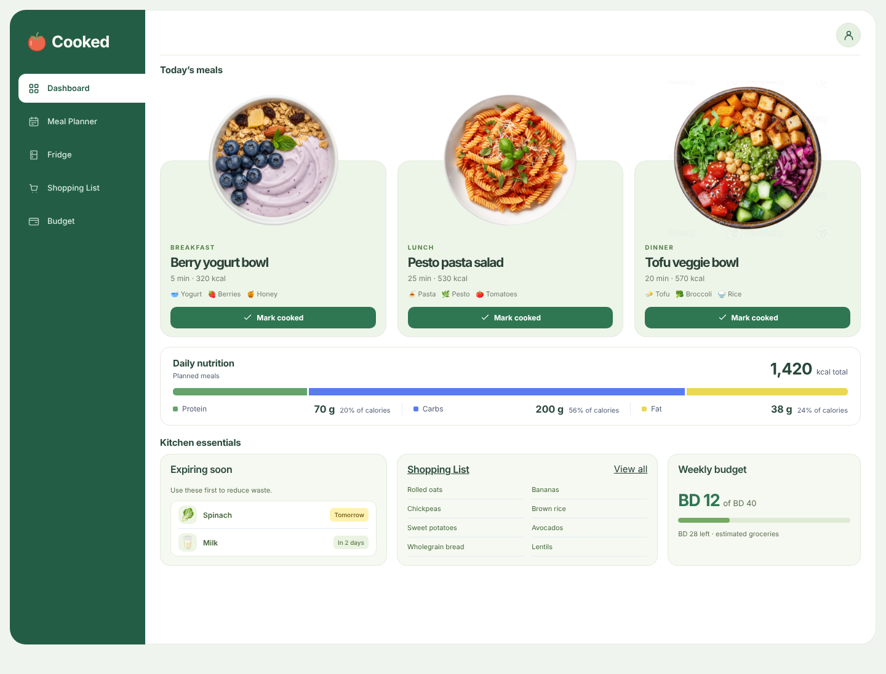
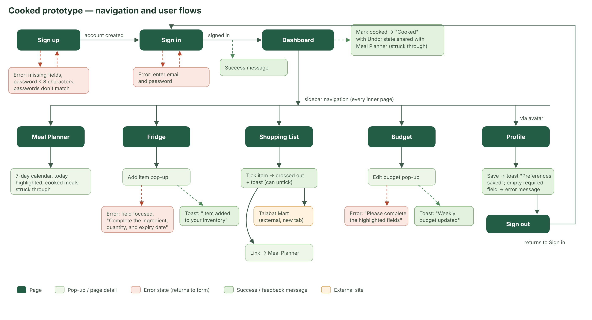
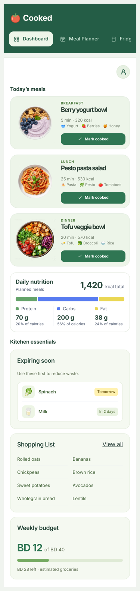

# Cooked – Meal Planner

Cooked is a web app that helps students and households plan a week of meals around the food they already have. It tracks what's in your fridge and what expires soon, then builds a weekly meal plan from it. From the plan it makes a shopping list for what's missing, with Talabat Mart links to buy those items. It also tracks your weekly grocery budget in Bahraini Dinar.

COSC 484 / 485 Web Engineering project, supervised by Dr. Husain Hameed.

**Live prototype:** https://zainmayoof.github.io/Meal-Planner/



## Current stage: interactive prototype

The `prototype` branch holds a clickable front-end prototype built with HTML, CSS and JavaScript. Our instructor approved this in place of Figma. Every page is linked, and each form has working validation, error messages and success messages. Sample data and the browser's `localStorage` stand in for the backend, which comes in the next milestone.

### Run it locally

No install or build step is needed.

1. Clone the repo and switch to the prototype branch:
   ```bash
   git clone https://github.com/ZainMayoof/Meal-Planner.git
   cd Meal-Planner
   git checkout prototype
   ```
2. Open `index.html` (or `pages/Sign-in.html`) in Chrome, Edge or Safari.
3. Enter any email and password to sign in. You can also create an account first: the name you choose then appears in the app.

Keep the `pages` and `assets` folders together. The pages load their styles, scripts and images from `assets`.

### Pages

| Page | File | What it covers |
|---|---|---|
| Sign in / Sign up | `pages/Sign-in.html`, `pages/Sign-up.html` | Account creation with diet and calorie target, plus form validation (UC01, UC02) |
| Dashboard | `pages/Cooked.html` | Today's meals with Mark cooked / Undo, daily nutrition, expiring items, shopping list and budget summary (UC06, UC08–UC10) |
| Meal Planner | `pages/Meal-planner.html` | 7-day calendar of breakfast, lunch and dinner (UC06, UC07) |
| Fridge | `pages/Fridge.html` | Inventory with expiry badges and an Add item pop-up (UC03) |
| Shopping List | `pages/Shopping-list.html` | Checklist of missing items with Talabat Mart links (UC08) |
| Budget | `pages/Budget.html` | Weekly budget, spending by category, Edit budget pop-up (UC09) |
| Profile | `pages/Profile.html` | Diet, calorie target, budget and allergy preferences; sign out (UC02) |

### Navigation and user flows



### Responsive and accessible

- The layout works from 360 px phones to 1920 px desktops. On phones the sidebar becomes a scrolling tab bar, and grids collapse to one column.



- We checked all pages with the axe-core accessibility checker against WCAG 2.1 AA. The first scan found 97 problems, mostly text with too little contrast. After our fixes all pages pass with 0.
- Every form field has a label, and every page can be used with the keyboard alone. Screen readers announce feedback messages, and status badges use text as well as colour.

## Project structure

```
index.html            Redirects to the sign-in page
pages/                One HTML file per screen
assets/css/styles.css Shared styles and design tokens (colours, spacing)
assets/js/app.js      Shared behaviour: pop-ups, messages, form validation, search
assets/images/        Meal photos
docs/                 Screenshots and the navigation-flow diagram
```

## Planned full stack

| Layer | Technology |
|---|---|
| Frontend | React, Tailwind CSS |
| Backend | Node.js, Express.js (REST API) |
| Database | MongoDB Atlas |
| Authentication | JWT, bcrypt |
| External services | Spoonacular Recipe API, Talabat Mart search links |
| Hosting | Vercel (frontend), Render (backend), MongoDB Atlas |
| Testing | Jest, React Testing Library, Postman |

## Branches

| Branch | Purpose |
|---|---|
| `main` | Reviewed code only |
| `prototype` | HTML/CSS/JS interactive prototype (this milestone) |
| `frontend` | React layouts and reusable components |
| `auth-admin` | Authentication, profiles, roles and admin features |
| `database` | MongoDB Atlas setup, Mongoose models |
| `recipes` | Recipe discovery and Spoonacular integration |
| `meal-planner` | Weekly meal planning, shopping lists and budgeting |

All work is done on a feature branch and merged through a pull request after a teammate reviews it.

## Team

| Name | ID | Role |
|---|---|---|
| Alya Altawash | F2300202 | UI/UX design lead |
| Hamza Alkhaldi | F2300066 | Backend development and security |
| Hana Wahban | F2300076 | Database development |
| Zain Mayoof | A01095 | API integration, meal planning, UI support |
